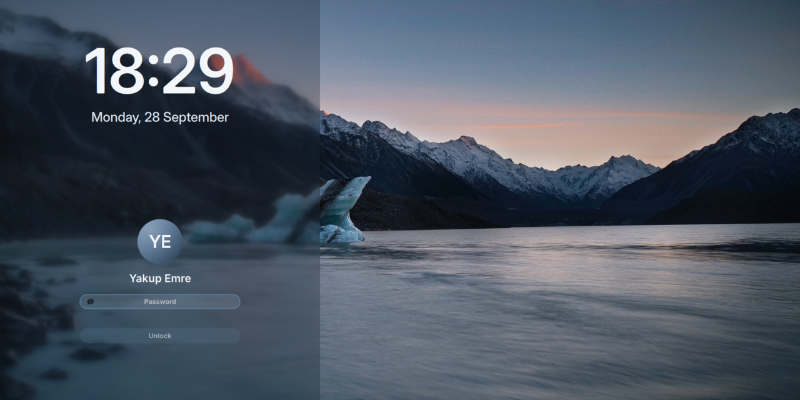

# yakupemre-lockscreen

A calm Plasma 6 lock screen: the same glacier lake at dusk, frosted side panel, Inter type and round avatar as its sibling login theme, so locking and logging in look like one screen.

[](LICENSE)


[](https://github.com/YakupEmreYerli/yakupemre-lockscreen/actions/workflows/ci.yml)

> Türkçe: [README.tr.md](README.tr.md)



## Sibling project

This is the lock screen half of a pair. The login screen is **[yakupemre-sddm](https://github.com/YakupEmreYerli/yakupemre-sddm)**: same background, palette, clock and form. Install both and the screen you see after boot, after `Meta+L` and after waking up is the same one.

It also fits auto-login setups: log in automatically, lock right away (`LockOnStart=true` in `kscreenlockerrc`), and the first thing anyone sees is still a password prompt.

## What you get

- **The yakupemre-sddm layout.** Frosted left panel, large Inter Display clock, date, round avatar, your name, a pill password field and an Unlock button.
- **Your avatar.** Read from `~/.face.icon`; the installer links the picture KDE System Settings stores in AccountsService. Falls back to your initials on a glacier-blue disc.
- **Media controls.** When something is playing, a glass card shows the cover, title and artist with previous / play-pause / next.
- **Caps Lock warning and a shake on a wrong password.**
- **English and Turkish**, picked from your system locale.

## Requirements

- KDE Plasma 6 on Wayland (tested on Plasma 6.7)
- Qt 6.5+ (`QtQuick.Effects`)
- The [Inter](https://rsms.me/inter/) font (`inter-font` on Arch)

## Install

Run as your normal user, not root:

```bash
git clone https://github.com/YakupEmreYerli/yakupemre-lockscreen.git
cd yakupemre-lockscreen
./install.sh
```

Then lock the screen with `Meta+L`.

Preview without locking (a window opens; close it or unlock with your password):

```bash
/usr/lib/kscreenlocker_greet --testing --shell ~/.local/share/plasma/shells/yakupemre-lockscreen
```

Remove it again with `./uninstall.sh`.

## How it hooks in

Plasma 6 has no setting for the lock screen layout. The greeter loads `lockscreen/LockScreen.qml` from the **shell package** named by `ShellPackage` in `plasmashellrc`. This project is a shell package that contains only a lock screen; everything else falls back to the stock `org.kde.plasma.desktop` shell.

`plasmashell` reads the same key, so the installer also:

- adds a systemd drop-in that starts `plasmashell --shell-plugin org.kde.plasma.desktop`, keeping your desktop on the stock shell;
- links `plasma-yakupemre-lockscreen-appletsrc` to your real layout file, in case `plasmashell` is started by hand.

If the QML ever fails to load (for example after a Plasma update), kscreenlocker falls back to its built-in lock screen, so you can always unlock.

## Customizing

Edit the files in `~/.local/share/plasma/shells/yakupemre-lockscreen/contents/lockscreen/` (or in this repo and run `./install.sh` again):

| What | Where |
| --- | --- |
| Background | `assets/glacier-lake.jpg` |
| Colors | `readonly property color …` at the top of `LockScreenUi.qml` |
| Texts and date format | `strings` in `LockScreenUi.qml` |

## Project layout

```
package/metadata.json              shell package (Plasma/Shell, falls back to org.kde.plasma.desktop)
package/contents/lockscreen/       LockScreen.qml (entry), LockScreenUi.qml, Avatar, MediaControls, GlassButton
package/contents/lockscreen/assets glacier-lake.jpg, password icons
install.sh / uninstall.sh          per-user installer
```

## Credits

- Look and assets: [yakupemre-sddm](https://github.com/YakupEmreYerli/yakupemre-sddm), itself built on [sddm-astronaut-theme](https://github.com/Keyitdev/sddm-astronaut-theme) by Keyitdev (GPL-3.0).
- Lock screen contract and media controls follow the stock Plasma lock screen by KDE (GPL-2.0-or-later).
- Background: glacier lake photo from the [dharmx/walls](https://github.com/dharmx/walls) collection. The original photographer is not credited there; if this is your work, open an issue and it will be credited or removed.

## License

GPL-3.0-or-later. See [LICENSE](LICENSE).
