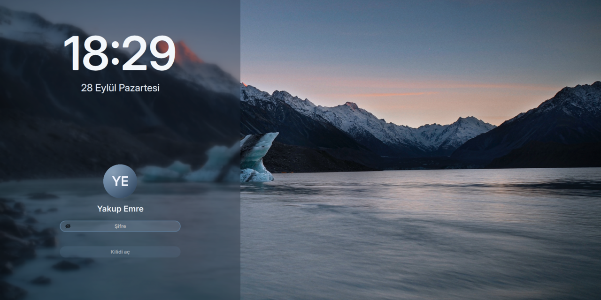

# yakupemre-lockscreen

Sakin bir Plasma 6 kilit ekranı. Kardeşi olan giriş temasındaki alacakaranlık buzul gölü, buzlu cam yan panel, Inter yazı tipi ve yuvarlak avatar burada da aynı; kilit ekranıyla giriş ekranı tek bir ekran gibi görünür.

[](LICENSE)


[](https://github.com/YakupEmreYerli/yakupemre-lockscreen/actions/workflows/ci.yml)

> English: [README.md](README.md)



## Kardeş proje

Bu, bir ikilinin kilit ekranı tarafı. Giriş ekranı tarafı **[yakupemre-sddm](https://github.com/YakupEmreYerli/yakupemre-sddm)**: aynı arka plan, renk paleti, saat ve form. İkisini birden kurarsanız açılışta, `Meta+L`'den sonra ve uykudan uyanınca karşınıza hep aynı ekran çıkar.

Otomatik girişle de iyi gider: oturum kendiliğinden açılır, hemen kilitlenir (`kscreenlockerrc` içinde `LockOnStart=true`) ve ekrana kim bakarsa baksın ilk gördüğü şey yine şifre alanı olur.

## Neler var

- **yakupemre-sddm yerleşimi.** Buzlu cam sol panel, büyük Inter Display saat, tarih, yuvarlak avatar, adınız, kapsül biçiminde bir şifre alanı ve Kilidi aç düğmesi.
- **Avatarınız.** `~/.face.icon` dosyasından okunur; kurulum betiği bu dosyayı, KDE Sistem Ayarları'nın AccountsService'te sakladığı resme bağlar. Resim yoksa buzul mavisi bir dairenin üstünde adınızın baş harfleri görünür.
- **Medya kontrolleri.** Bir şey çalarken cam bir kartta kapak, parça adı ve sanatçı görünür; yanında önceki / oynat-duraklat / sonraki düğmeleri.
- **Caps Lock uyarısı; yanlış şifre girilince form sallanır.**
- **İngilizce ve Türkçe**, sistem dilinize göre seçilir.

## Gerekenler

- Wayland üzerinde KDE Plasma 6 (Plasma 6.7'de denendi)
- Qt 6.5+ (`QtQuick.Effects`)
- [Inter](https://rsms.me/inter/) yazı tipi (Arch'ta `inter-font`)

## Kurulum

root ile değil, kendi kullanıcınızla çalıştırın:

```bash
git clone https://github.com/YakupEmreYerli/yakupemre-lockscreen.git
cd yakupemre-lockscreen
./install.sh
```

Sonra ekranı `Meta+L` ile kilitleyin.

Kilitlemeden önizlemek için (bir pencere açılır; kapatın ya da şifrenizle kilidi açın):

```bash
/usr/lib/kscreenlocker_greet --testing --shell ~/.local/share/plasma/shells/yakupemre-lockscreen
```

Kaldırmak için: `./uninstall.sh`.

## Plasma'ya nasıl bağlanır

Plasma 6'da kilit ekranının yerleşimi için bir ayar yok. Kilit ekranı programı, `plasmashellrc` içindeki `ShellPackage` anahtarının gösterdiği **kabuk paketinden** (shell package) `lockscreen/LockScreen.qml` dosyasını yükler. Bu proje yalnızca kilit ekranı içeren bir kabuk paketi; geri kalan her şey için Plasma'nın standart `org.kde.plasma.desktop` kabuğu kullanılır.

`plasmashell` de aynı anahtarı okuduğu için kurulum betiği ayrıca:

- `plasmashell --shell-plugin org.kde.plasma.desktop` komutunu başlatan bir systemd drop-in dosyası ekler, böylece masaüstünüz standart kabukta kalır;
- `plasmashell` elle başlatılırsa diye `plasma-yakupemre-lockscreen-appletsrc` dosyasını gerçek yerleşim dosyanıza bağlar.

QML bir gün yüklenemezse (örneğin bir Plasma güncellemesinden sonra) kscreenlocker kendi yerleşik kilit ekranına döner, yani kilidi her zaman açabilirsiniz.

## Özelleştirme

`~/.local/share/plasma/shells/yakupemre-lockscreen/contents/lockscreen/` içindeki dosyaları düzenleyin (ya da bu depodakileri düzenleyip `./install.sh` komutunu yeniden çalıştırın):

| Ne | Nerede |
| --- | --- |
| Arka plan | `assets/glacier-lake.jpg` |
| Renkler | `LockScreenUi.qml` dosyasının başındaki `readonly property color …` satırları |
| Metinler ve tarih biçimi | `LockScreenUi.qml` içindeki `strings` |

## Proje düzeni

```
package/metadata.json              kabuk paketi (Plasma/Shell, eksik kalanı org.kde.plasma.desktop'tan alır)
package/contents/lockscreen/       LockScreen.qml (giriş noktası), LockScreenUi.qml, Avatar, MediaControls, GlassButton
package/contents/lockscreen/assets glacier-lake.jpg, şifre simgeleri
install.sh / uninstall.sh          yalnız sizin kullanıcınıza kuran betikler
```

## Emeği geçenler

- Görünüm ve görseller: [yakupemre-sddm](https://github.com/YakupEmreYerli/yakupemre-sddm); o da Keyitdev'in [sddm-astronaut-theme](https://github.com/Keyitdev/sddm-astronaut-theme) teması (GPL-3.0) üzerine kurulu.
- Kilit ekranının uyduğu arayüz ve medya kontrolleri, KDE'nin standart Plasma kilit ekranını (GPL-2.0-or-later) örnek alır.
- Arka plan: [dharmx/walls](https://github.com/dharmx/walls) koleksiyonundaki buzul gölü fotoğrafı. Orada fotoğrafçının adı geçmiyor; fotoğraf sizinse bir issue açın, adınız eklenir ya da fotoğraf kaldırılır.

## Lisans

GPL-3.0-or-later. Bkz. [LICENSE](LICENSE).
